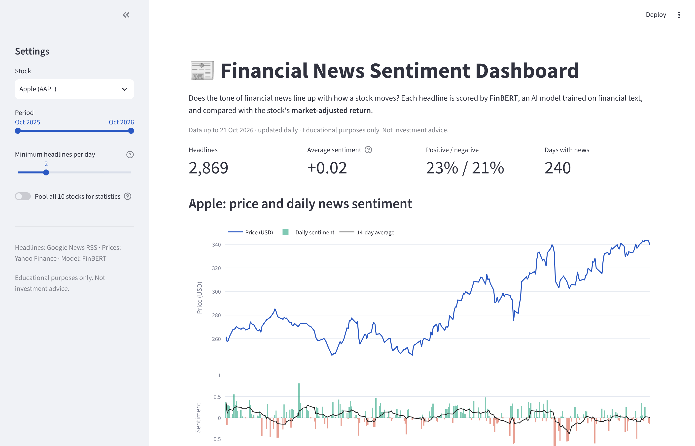

# 📰 Financial News Sentiment Dashboard

Does the tone of financial news line up with how a stock moves?
This tool scores news headlines with **FinBERT**, an AI language model trained on financial text, and compares daily sentiment with **market-adjusted stock returns** for ten large global companies. New headlines are collected and scored automatically every trading day.

**[▶ Live demo](https://news-sentiment-dashboard-787.streamlit.app)** · no install, runs in your browser



> Educational purposes only. Not investment advice.

---

## What it shows

- **Price vs sentiment:** share price above, daily news sentiment below, with a 14-day average.
- **Statistics:** correlation between sentiment and abnormal returns on the previous day, same day and next day, with p-values and a plain-English reading. Can pool all ten stocks for more data.
- **Sentiment groups:** average abnormal return on the most negative, middle and most positive third of news days.
- **Headline table:** every headline with its label, score, source and link.
- **Try it yourself:** type any headline and FinBERT scores it live.

Watchlist (all US-listed): Apple, Microsoft, Nvidia, Amazon, Tesla, JPMorgan, ExxonMobil, Shell, Toyota, Alibaba. Benchmark: SPY (S&P 500 ETF).

## Methodology

**1. Collect.** Headlines come from Google News RSS (search `"<Company>" stock`). Only headlines naming the company are kept, and syndicated duplicates are removed. History was backfilled week by week; since then a GitHub Actions job adds new headlines every weekday after the US close.

**2. Score.** FinBERT ([ProsusAI/finbert](https://huggingface.co/ProsusAI/finbert)) returns three probabilities per headline. One score combines them:

$$\text{score} = P(\text{positive}) - P(\text{negative}) \qquad \in [-1, 1]$$

**3. Align with trading days.** News published after the 16:00 New York close, or on a weekend or holiday, can only affect the next trading day, so it is assigned there. Daily sentiment is the mean score of that day's headlines:

$$S_{i,t} = \frac{1}{N_{i,t}} \sum_{k=1}^{N_{i,t}} \text{score}_k$$

**4. Returns.** Simple daily return and market-adjusted (abnormal) return, which removes moves that hit the whole market:

$$r_{i,t} = \frac{P_{i,t}}{P_{i,t-1}} - 1 \qquad AR_{i,t} = r_{i,t} - r_{\text{SPY},t}$$

**5. Test.** Pearson and Spearman correlation between $S_{i,t}$ and $AR_{i,t-1}$, $AR_{i,t}$ and $AR_{i,t+1}$:

| Horizon | Question it asks |
|---|---|
| $t-1$ | Does news *follow* prices? (reporters explaining yesterday's move) |
| $t$ | Do news and prices move *together*? |
| $t+1$ | Does news *predict* tomorrow's return? Under market efficiency, this should be near zero. |

## Run it locally

```bash
git clone https://github.com/KhanFT787/news-sentiment-dashboard.git
cd news-sentiment-dashboard
python -m venv .venv && source .venv/bin/activate   # Windows: .venv\Scripts\activate
pip install -r requirements.txt
streamlit run app.py          # open the dashboard
pytest                        # run the tests
python scripts/collect.py     # optional: fetch and score today's news
```

No API keys are needed. The first FinBERT run downloads the model (about 440 MB).

## Project structure

```
├── app.py                      Streamlit dashboard
├── src/
│   ├── config.py               watchlist and settings
│   ├── fetch.py                headlines (Google News RSS) and prices (Yahoo Finance)
│   ├── sentiment.py            FinBERT scoring
│   ├── analysis.py             trading-day alignment, returns, correlations
│   └── storage.py              read/write CSV data
├── scripts/collect.py          daily collection job
├── data/                       headlines (one CSV per month) and prices
├── tests/                      unit tests on synthetic data
└── .github/workflows/daily.yml automated daily update
```

## Data sources

| Data | Source | Notes |
|---|---|---|
| Headlines | Google News RSS | Headline text, source, link and time only. Articles stay with their publishers. |
| Prices | Yahoo Finance via `yfinance` | Daily adjusted close |
| Model | FinBERT (Araci, 2019), Hugging Face | Apache 2.0 licence |

## Limitations

- Headlines only, not full articles. Google News coverage varies by stock and over time.
- Backfilled headlines carry date-level timestamps, so some after-close news may be assigned to the wrong day. Headlines collected daily have exact times.
- FinBERT misreads some headlines: questions ("Should you buy...?"), sarcasm, and passing mentions of a company.
- Ten large, heavily covered companies cannot represent the whole market, and small caps behave differently.
- Many correlations are tested, so a few will look "significant" by chance. Correlation is not causation, and this is not a trading signal.

## References

- Araci, D. (2019). *FinBERT: Financial Sentiment Analysis with Pre-trained Language Models.* arXiv:1908.10063.
- Tetlock, P. C. (2007). Giving content to investor sentiment: The role of media in the stock market. *Journal of Finance*, 62(3), 1139–1168.
- Fama, E. F. (1970). Efficient capital markets: A review of theory and empirical work. *Journal of Finance*, 25(2), 383–417.

## Licence

MIT. See [LICENSE](LICENSE).

Built by [Mehedi Hasan Khan](https://www.linkedin.com/in/khan787/).
